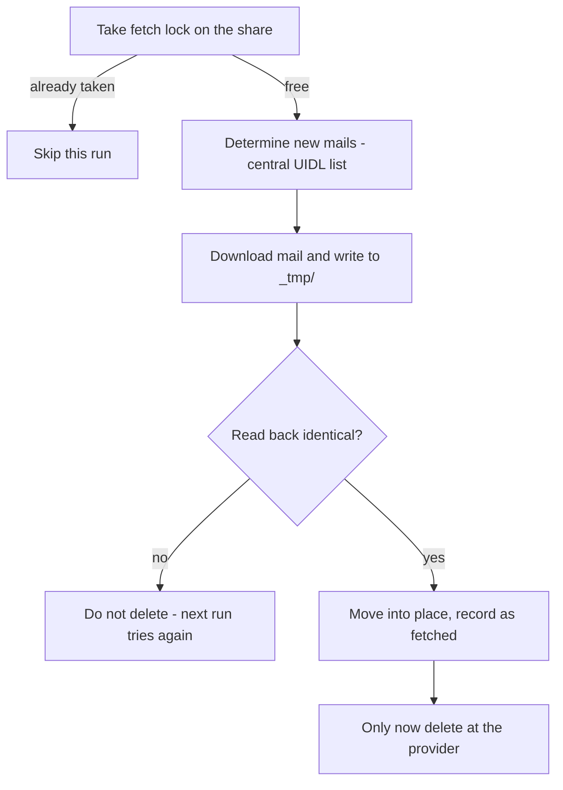
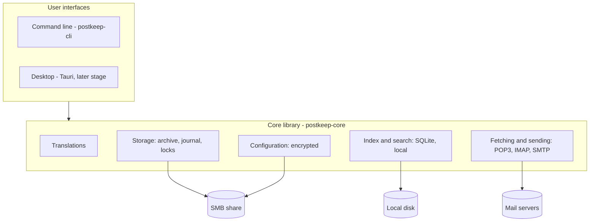

# Architecture

This document explains how Postkeep is built and *why* certain decisions were made. It is aimed at
contributors who want to change code, not at users (see the
[user manual in the wiki](https://github.com/chrisschm/postkeep/wiki) for that). It is updated with
every development step - if code and this document disagree, please report it.
*(Eine deutsche Kurzfassung findest du am Ende dieser Datei.)*

Throughout this document, **[implemented]** and **[planned]** mark what already exists in the code
and what is only designed so far.

## Purpose

Postkeep is a mail client for Windows and Linux whose archive lives on a **shared network drive**
(an SMB share, e.g. on a NAS) as **plain individual files** - one `.eml` file per mail, later
`.vcf` for contacts and `.ics` for calendar entries. Several computers can work on the same archive
**at the same time** without damaging it.

It is meant as a replacement for a setup that is common in small offices and households: several
computers running a desktop mail program on one shared mailbox file (such as an Outlook `.pst`) on
a network drive. That setup is not designed for concurrent access, risks damage to large parts of
the archive at once, and ties the archive to one vendor's program.

### The usage model Postkeep keeps

- Mail accounts are fetched via **POP3 with deletion after download**. The archive on the share is
  then the **only copy** of the mail - there is no copy left at the provider to fall back on.
- IMAP accounts are supported in addition (e.g. a mailbox also used on a phone).
- No own mail server is needed. Postkeep must remain usable for people who are not IT experts.
- One user, several computers (Windows and Linux mixed). All computers show the same state (read,
  flagged, answered, folders) within a few seconds.

Because the archive is the only copy, **reliability is the main design goal**, not features. The
safety rules below are therefore not negotiable.

## Safety rules (non-negotiable)

Every change must preserve these rules. Each rule needs unit tests, especially for the error cases.

1. **Never delete at the provider before the mail is verifiably on the share.** Order: write to
   `mail/_tmp/` → read back and compare → move into place by renaming → record in the fetch list →
   only then `DELE`. Any error before the last step: do not delete. Fetching a mail twice is
   acceptable, losing one never is. *[planned]*
2. **Fetch only while holding a lock** in `locks/` (a file with timestamp and computer id that
   expires after a few minutes, so a crashed computer does not block the others forever). The list
   of already fetched mails (POP3 UIDLs) is kept centrally on the share. *[planned]*
3. **No two computers ever write to the same file.** New objects are new files with a globally
   unique name (timestamp + computer id + random part). Existing files are never overwritten.
   *[planned]*
4. **Mail files are immutable.** Status (read, flagged, answered) is not stored in the mail but in
   a **journal per computer** (`journal/<computer>`, append-only), which all computers merge.
   *[planned]*
5. **Moving is renaming.** Deleting means moving into the trash; final deletion only after a
   configurable period. *[planned]*
6. **No database on the share.** Databases over SMB are exactly the kind of risk Postkeep exists
   to remove. The search index (SQLite with full-text search) lives on each computer's local disk
   and can be rebuilt from the share at any time. *[planned]*
7. **No fetching without a reachable share** - otherwise there would be no safe place for the mail.
   *[planned]*
8. **Credentials only encrypted** in `config/`: key derived from a master password (Argon2id),
   authenticated encryption, one file per account. Never in plain text, never in logs.
   *[planned]*
9. **HTML mails are displayed isolated:** no scripts, no external content (images, fonts,
   tracking pixels) unless the user allows it for a sender. *[planned]*

## Archive layout on the share *[planned]*

```
<archive>/
  config/            accounts, servers, signatures, rules (encrypted)
  mail/
    inbox/2026/      one .eml file per mail, grouped by year
    <own folder>/2025/
    _tmp/            staging area for writes in progress
  contacts/          one .vcf file per contact (later stage)
  calendar/          one .ics file per event (later stage)
  journal/           status change logs, one per computer
  locks/             short-lived locks, e.g. for POP3 fetching
```

- **Year folders**, because listing very large directories over SMB is slow.
- **Language-neutral names:** standard folders have fixed names (`inbox`, `sent`, `trash`, ... -
  the final list is defined together with the storage layer); only their *display* is translated.
  Computers with different user interface languages work on the same archive, so the data on the
  share must never contain translated text. Folders created by the user keep the user's name.
  Journal and configuration contain identifiers only.
- **Side effect:** snapshots of the network drive (e.g. on a NAS) can restore single mails.

## Concurrent access *[planned]*

| Situation | Behaviour |
|---|---|
| Computer A reads a mail while B flags it | Journal entries are merged: read *and* flagged |
| A and B move the same mail to different folders | The first rename wins; B shows the new location |
| A and B edit the same contact (later stage) | The newer version wins, the older one is kept as a version |
| Crash while writing | Leftovers exist only in `_tmp/` and are cleaned up on the next start |

Changes by other computers are detected by checking the share every few seconds. SMB change
notifications may be used where they work reliably, but are never relied upon.

## POP3 fetching with deletion *[planned]*



POP3 itself helps here: `DELE` only takes effect at a proper `QUIT`. If the connection breaks
before, everything stays at the provider. POP3 is implemented in Postkeep itself (it is a small
protocol, and the safety chain must be fully under our control); mail parsing, SMTP, IMAP, vCard,
iCalendar and encryption use mature libraries.

## Settings

- **Central, on the share, encrypted:** accounts, servers, ports, encryption, fetch intervals,
  signatures, rules, folders, identities. Setting up an additional computer means: install, choose
  the archive folder, enter the master password - done. *[planned]*
- **Local, per computer:** appearance, notifications, user interface language, and whether this
  computer is allowed to fetch mail. *[planned]*

## Components



- **`postkeep-core`** (Rust library) contains everything the user interfaces build on. It knows
  only files, protocols and index entries - nothing about windows or terminals. *[implemented:
  translations only]*
- **`postkeep-cli`** (program `postkeep`) is the only user interface during the proof of concept
  and the tool to exercise the core on real network shares. *[implemented: overview, `--help`,
  `--version`, `--lang`]*
- **Desktop interface** with [Tauri](https://tauri.app/) (Rust backend, system web view for the
  window contents). *[planned, later stage]*
- **Modules** for data types: each data type (mail first; contacts and calendar later) plugs into
  the core through one interface - file format, folders, index fields, view, events - so contacts
  and calendar can be added later without restructuring. Birthdays come only from the contact's
  vCard `BDAY` field, never as separate calendar entries. *[planned]*
- **Phone synchronisation** of contacts and calendar only via open standards (CardDAV/CalDAV),
  never tied to one vendor. *[planned, optional later stage]*

### Why Rust and Tauri

Postkeep parses untrusted input (mails from strangers: MIME, HTML) and guards the only copy of the
user's mail, so memory safety matters a lot - Rust provides it, and our own code forbids `unsafe`
entirely (`unsafe_code = "forbid"` in the workspace `Cargo.toml`). Tauri keeps the programs small
and runs on Windows and Linux from one code base. Alternatives considered: Electron (large,
memory-hungry), Qt (native look, but more user interface work, and HTML mails would still need a
web engine).

## Translations *[implemented]*

All user-visible texts are translated; the code contains no user-visible text. Details and the
rules for adding texts or languages are in the module documentation of
`crates/postkeep-core/src/i18n.rs`. In short:

- Format: [Project Fluent](https://projectfluent.org/) (`.ftl`), as used by Firefox and
  Thunderbird. It lets each language express its own grammar (e.g. plural forms) without the code
  knowing about it.
- Files: `crates/postkeep-core/locales/<language>/postkeep.ftl`, compiled into the program.
  Only the core holds translations; user interfaces get their texts from it.
- English is the base language and the fallback for every lookup; German is complete. A unit test
  fails if a message exists in one language file but not in another.
- The language follows the operating system and can be overridden (command line: `--lang`).
- Log output for developers stays in English.
- The data on the share is language-neutral (see "Archive layout" above).

## Dependencies

- Every dependency must have a license compatible with GPL-3.0-or-later. `cargo deny check`
  enforces this together with known security advisories and allowed sources; the configuration is
  `deny.toml` in the repository root.
- Each dependency is a deliberate choice; the reason is noted next to it in the workspace
  `Cargo.toml`. Current dependencies: `fluent-bundle`, `fluent-langneg`, `unic-langid`,
  `sys-locale` (translations); `fluent-syntax` (tests only).
- `fluent-langneg` must stay on the version `fluent-bundle` itself uses (see the note in
  `Cargo.toml`).

## Status and stages

| Stage | Scope | Status |
|---|---|---|
| 0 Proof of concept | Storage format, POP3 safety chain, journal, multi-day test with two computers at once, simple command-line view | **in progress:** workspace, translations and command-line skeleton done |
| 1 Basic mail client | Reading, writing, SMTP, folders, search, central settings, IMAP, import from Outlook `.pst` | planned |
| 2 Everyday comfort | Rules, signatures, drafts, attachments, notifications, installer | planned |
| 3 Contacts | vCard address book, birthday overview, address completion | planned |
| 4 Calendar | Events, recurrences, time zones, invitations | planned |
| 5 Phone (optional) | CardDAV/CalDAV | open |

---

## Auf Deutsch (Kurzfassung)

Postkeep ist ein Mailprogramm für Windows und Linux. Das Archiv liegt als **einzelne, offene
Dateien** (`.eml`, später `.vcf`, `.ics`) auf einem **Netzlaufwerk**; mehrere Rechner arbeiten
gleichzeitig darauf. Konten werden per POP3 **mit Löschung nach Abholung** abgerufen - das Archiv
ist damit die **einzige Kopie** der Mails. Deshalb ist Zuverlässigkeit das wichtigste Ziel.

- **Sicherheitsregeln (unverhandelbar):** erst nach Zurücklesen und Ablage beim Provider löschen;
  Abruf nur unter Sperre; nie zwei Rechner in dieselbe Datei; Mail-Dateien unveränderlich, Status im
  Journal pro Rechner; Verschieben = Umbenennen; keine Datenbank auf dem Share (Suchindex lokal);
  ohne Share kein Abruf; Zugangsdaten nur verschlüsselt; HTML-Mails abgeschottet.
- **Ablage:** feste, sprachneutrale Namen für Standardordner, Jahresordner, `_tmp/` für laufende
  Schreibvorgänge, `journal/`, `locks/`.
- **Aufbau:** Kern-Bibliothek `postkeep-core` (Rust), Kommandozeile `postkeep-cli`, später
  Desktop-Oberfläche mit Tauri; Kontakte und Kalender später als Module.
- **Übersetzungen:** Project Fluent, Englisch als Grundsprache und Rückfall, Deutsch vollständig;
  Daten auf dem Share sprachneutral.
- **Stand:** Stufe 0 (Machbarkeitsnachweis) läuft - Workspace, Übersetzungen und CLI-Gerüst sind
  umgesetzt, alles andere ist mit *[planned]* gekennzeichnet.
