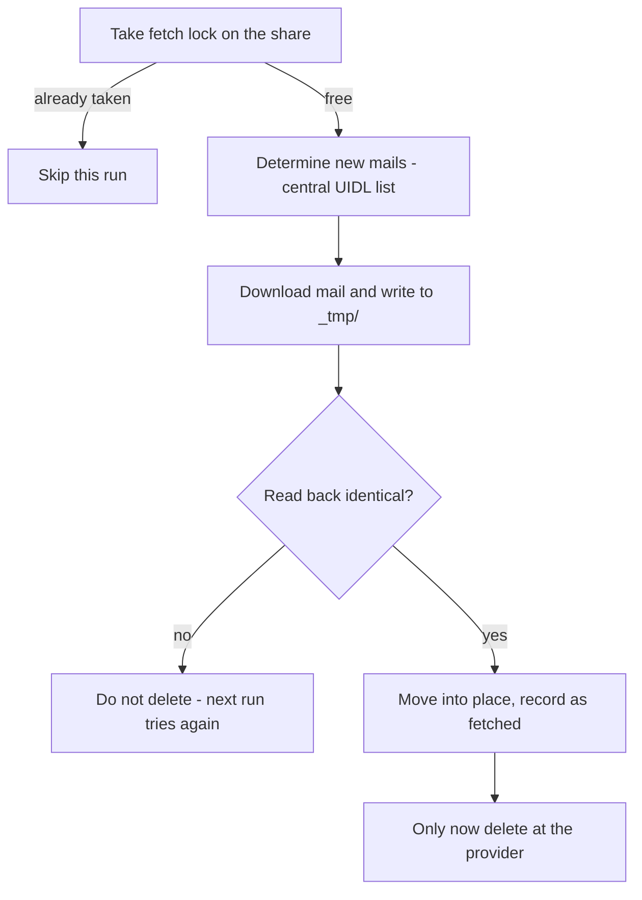
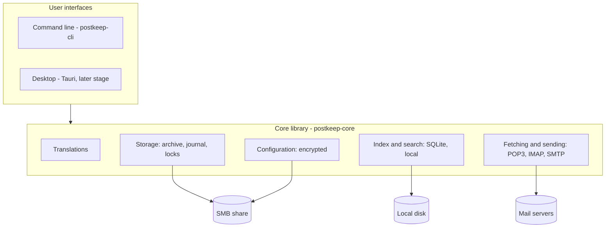

# Architecture

This document explains how Postkeep is built and *why* certain decisions were made. It is aimed at
contributors who want to change code, not at users (see the
[user manual in the wiki](https://github.com/chrisschm/postkeep/wiki) for that). It is updated with
every development step - if code and this document disagree, please report it.
*(Eine deutsche Kurzfassung findest du am Ende dieser Datei.)*

Throughout this document, **[implemented]** and **[planned]** mark what already exists in the code
and what is only designed so far.

## Purpose

Postkeep is a mail client for Windows and Linux whose archive lives on a **shared network drive**
(an SMB share, e.g. on a NAS) as **plain individual files** - one `.eml` file per mail, later
`.vcf` for contacts and `.ics` for calendar entries. Several computers can work on the same archive
**at the same time** without damaging it.

It is meant as a replacement for a setup that is common in small offices and households: several
computers running a desktop mail program on one shared mailbox file (such as an Outlook `.pst`) on
a network drive. That setup is not designed for concurrent access, risks damage to large parts of
the archive at once, and ties the archive to one vendor's program.

### The usage model Postkeep keeps

- Mail accounts are fetched via **POP3 with deletion after download**. The archive on the share is
  then the **only copy** of the mail - there is no copy left at the provider to fall back on.
- IMAP accounts are supported in addition (e.g. a mailbox also used on a phone).
- No own mail server is needed. Postkeep must remain usable for people who are not IT experts.
- One user, several computers (Windows and Linux mixed). All computers show the same state (read,
  flagged, answered, folders) within a few seconds.

Because the archive is the only copy, **reliability is the main design goal**, not features. The
safety rules below are therefore not negotiable.

## Safety rules (non-negotiable)

Every change must preserve these rules. Each rule needs unit tests, especially for the error cases.

1. **Never delete at the provider before the mail is verifiably on the share.** Order: write to
   `mail/_tmp/` → read back and compare → move into place by renaming → record in the fetch list →
   only then `DELE`. Any error before the last step: do not delete. Fetching a mail twice is
   acceptable, losing one never is. *[planned]*
2. **Fetch only while holding a lock** in `locks/` (a file with timestamp and computer id that
   expires after a few minutes, so a crashed computer does not block the others forever). The list
   of already fetched mails (POP3 UIDLs) is kept centrally on the share. *[planned]*
3. **No two computers ever write to the same file.** New objects are new files with a globally
   unique name (timestamp + computer id + random part). Existing files are never overwritten.
   *[implemented for mails]*
4. **Mail files are immutable.** Status (read, flagged, answered) is not stored in the mail but in
   a **journal per computer** (`journal/<computer>`, append-only), which all computers merge.
   *[implemented: immutable mail files; planned: journal]*
5. **Moving is renaming.** Deleting means moving into the trash; final deletion only after a
   configurable period. *[implemented: moving; planned: trash period]*
6. **No database on the share.** Databases over SMB are exactly the kind of risk Postkeep exists
   to remove. The search index (SQLite with full-text search) lives on each computer's local disk
   and can be rebuilt from the share at any time. *[planned]*
7. **No fetching without a reachable share** - otherwise there would be no safe place for the mail.
   *[planned]*
8. **Credentials only encrypted** in `config/`: key derived from a master password (Argon2id),
   authenticated encryption, one file per account. Never in plain text, never in logs.
   *[planned]*
9. **HTML mails are displayed isolated:** no scripts, no external content (images, fonts,
   tracking pixels) unless the user allows it for a sender. *[planned]*

## Archive layout on the share *[implemented: mail folders; planned: config, contacts, calendar, journal content, locks]*

```
<archive>/
  postkeep-archive.txt   identifies the folder as a Postkeep archive (storage format version)
  config/                accounts, servers, signatures, rules (encrypted, later)
  mail/
    inbox/2026/          one .eml file per mail, grouped by year
    sent/ drafts/ trash/ junk/ archive/
    <own folder>/2025/
    _tmp/                staging area for writes in progress
  contacts/              one .vcf file per contact (later stage)
  calendar/              one .ics file per event (later stage)
  journal/               status change logs, one per computer
  locks/                 short-lived locks, e.g. for POP3 fetching
```

The code is in `crates/postkeep-core/src/storage/`; its module documentation explains the details.

- **Postkeep creates the layout itself.** The user only chooses an empty folder; Postkeep writes
  `postkeep-archive.txt` first and then the directories. Opening an archive adds directories that
  are missing (e.g. folders introduced by a newer version). A folder without the identification
  file is refused, and so is an archive with an unknown (newer) storage format.
- **Standard folders** have fixed, lowercase English names: `inbox`, `sent`, `drafts`, `trash`,
  `junk`, `archive` (following common IMAP/Thunderbird usage). Only their *display* is translated:
  computers with different user interface languages work on the same archive, so the data on the
  share must never contain translated text. All of them are created with a new archive, also those
  only used in later stages.
- **Folders created by the user** keep the user's name, if it is a safe directory name on Windows,
  Linux and SMB: standard names are reserved regardless of case (SMB does not distinguish `Inbox`
  from `inbox`), names starting with `_` are reserved for internal directories such as `_tmp/`,
  and characters or names Windows does not allow are rejected. Subfolders are not supported yet.
- **File names** are globally unique without any coordination between computers:
  `<UTC timestamp>-<computer id>-<random>.eml`, e.g.
  `20261014T221530123Z-office-7f3a-9c41e2d0.eml`. The file name without `.eml` is the mail's
  permanent id; moving a mail keeps it.
- **Computer id:** the host name (lowercase, `a-z0-9-`, at most 20 characters) plus four random
  hex digits, e.g. `office-7f3a`. It is created once and stored on the computer's local disk, so it
  stays the same when the computer is renamed and differs between computers with the same name.
- **Year folders** by the time the mail was *stored* (UTC), not by the `Date:` header: the storage
  time always exists and is reliable, while `Date:` comes from the sender and can be missing, wrong
  or forged. Year folders only keep directories small (listing very large directories over SMB is
  slow); sorting for display comes from the local index.
- Journal and configuration contain identifiers only.
- **Side effect:** snapshots of the network drive (e.g. on a NAS) can restore single mails.

### Storing a mail *[implemented]*

1. Create the file under its final name in `mail/_tmp/` ("create new" - never overwrites).
2. Write the content and flush it to the share (`sync_all`).
3. Close, reopen and read it back; it must be byte-for-byte identical, otherwise the mail counts as
   not stored and the temporary file is removed.
4. Create the year folder if needed.
5. Rename the file into the year folder (refusing to overwrite).

A crash or error at any point leaves at most a file in `mail/_tmp/`, never a partial mail in a
folder; leftovers are removed later by the computer that created them (recognised by the computer
id in the name). Unit tests simulate a failure after every single step.

**Known limit of the read-back:** the operating system may answer it partly from its own cache
instead of the share. It reliably catches errors while writing, but cannot prove the bytes are on
the NAS's disk. The tests against a real share (see `CONTRIBUTING.md`) complement it.

## Concurrent access *[planned]*

| Situation | Behaviour |
|---|---|
| Computer A reads a mail while B flags it | Journal entries are merged: read *and* flagged |
| A and B move the same mail to different folders | The first rename wins; B shows the new location |
| A and B edit the same contact (later stage) | The newer version wins, the older one is kept as a version |
| Crash while writing | Leftovers exist only in `_tmp/` and are cleaned up on the next start |

Changes by other computers are detected by checking the share every few seconds. SMB change
notifications may be used where they work reliably, but are never relied upon.

### What other computers see, and when (measured)

Measurements with two Windows computers and a Linux (CIFS) client on a Synology NAS with default
settings gave the following picture. The design relies on it:

| What | Result |
|---|---|
| Write to `_tmp/`, then rename into a folder | **Atomic** - the other computer saw every file only complete (Windows and Linux) |
| Appending to an existing file (journal), reader keeps the file open | visible after **~50 ms** (Windows and Linux) |
| New file in a folder, seen by **Windows** in a folder listing | after **0-10 s** (Windows caches directory contents for 10 s) |
| New file, opened directly by name on **Windows** after the folder was listed | "not found" for up to **~10 s** |
| New file, opened directly by name on Windows, folder not listed before | ~15 ms |
| New file, seen by **Linux** (listing or opening by name) | ~15 ms |
| Appending, Linux reader opens and closes the file on every check | **never seen** while checking rapidly (the client keeps a closed file open for about a second and keeps using its cache) |
| SMB3 directory leasing switched on at the NAS | usually ~0.1 s, but about one in 10-15 changes stayed **invisible for over a minute** |

Consequences for the code:

- **New mails are announced in the journal**; the other computer then opens the file by name. A
  "file not found" shortly after an announcement is not an error: retry for about 15 seconds,
  then mark the mail as *pending* until a later attempt or the next reconciliation finds it.
- **Folder listings are only used for reconciliation**, never as a complete or current picture.
  What the user sees comes from the local index.
- **Other computers' journals are read through a file handle that stays open**, continuing at the
  last read position. Opening and closing on every check is unsuitable on Linux.
- **Correctness never depends on the server's caching or leasing behaviour.** Good leasing makes
  Postkeep faster; it must be correct without it. Directory leasing on the measured Synology NAS
  is not recommended. Other servers (e.g. Windows Server, where directory leasing is on by default,
  or other NAS) have not been measured yet.

## POP3 fetching with deletion *[planned]*



POP3 itself helps here: `DELE` only takes effect at a proper `QUIT`. If the connection breaks
before, everything stays at the provider. POP3 is implemented in Postkeep itself (it is a small
protocol, and the safety chain must be fully under our control); mail parsing, SMTP, IMAP, vCard,
iCalendar and encryption use mature libraries.

## Settings

- **Central, on the share, encrypted:** accounts, servers, ports, encryption, fetch intervals,
  signatures, rules, folders, identities. Setting up an additional computer means: install, choose
  the archive folder, enter the master password - done. *[planned]*
- **Local, per computer:** appearance, notifications, user interface language, and whether this
  computer is allowed to fetch mail. *[planned]*

## Components



- **`postkeep-core`** (Rust library) contains everything the user interfaces build on. It knows
  only files, protocols and index entries - nothing about windows or terminals. *[implemented:
  translations, storage of mails on the share]*
- **`postkeep-cli`** (program `postkeep`) is the only user interface during the proof of concept
  and the tool to exercise the core on real network shares. *[implemented: overview, `--help`,
  `--version`, `--lang`]*
- **Desktop interface** with [Tauri](https://tauri.app/) (Rust backend, system web view for the
  window contents). *[planned, later stage]*
- **Modules** for data types: each data type (mail first; contacts and calendar later) plugs into
  the core through one interface - file format, folders, index fields, view, events - so contacts
  and calendar can be added later without restructuring. Birthdays come only from the contact's
  vCard `BDAY` field, never as separate calendar entries. *[planned]*
- **Phone synchronisation** of contacts and calendar only via open standards (CardDAV/CalDAV),
  never tied to one vendor. *[planned, optional later stage]*

### Why Rust and Tauri

Postkeep parses untrusted input (mails from strangers: MIME, HTML) and guards the only copy of the
user's mail, so memory safety matters a lot - Rust provides it, and our own code forbids `unsafe`
entirely (`unsafe_code = "forbid"` in the workspace `Cargo.toml`). Tauri keeps the programs small
and runs on Windows and Linux from one code base. Alternatives considered: Electron (large,
memory-hungry), Qt (native look, but more user interface work, and HTML mails would still need a
web engine).

## Translations *[implemented]*

All user-visible texts are translated; the code contains no user-visible text. Details and the
rules for adding texts or languages are in the module documentation of
`crates/postkeep-core/src/i18n.rs`. In short:

- Format: [Project Fluent](https://projectfluent.org/) (`.ftl`), as used by Firefox and
  Thunderbird. It lets each language express its own grammar (e.g. plural forms) without the code
  knowing about it.
- Files: `crates/postkeep-core/locales/<language>/postkeep.ftl`, compiled into the program.
  Only the core holds translations; user interfaces get their texts from it.
- English is the base language and the fallback for every lookup; German is complete. A unit test
  fails if a message exists in one language file but not in another.
- The language follows the operating system and can be overridden (command line: `--lang`).
- Log output for developers stays in English.
- The data on the share is language-neutral (see "Archive layout" above).

## Dependencies

- Every dependency must have a license compatible with GPL-3.0-or-later. `cargo deny check`
  enforces this together with known security advisories and allowed sources; the configuration is
  `deny.toml` in the repository root.
- Each dependency is a deliberate choice; the reason is noted next to it in the workspace
  `Cargo.toml`. Current dependencies: `fluent-bundle`, `fluent-langneg`, `unic-langid`,
  `sys-locale` (translations); `fluent-syntax` (tests only).
- `fluent-langneg` must stay on the version `fluent-bundle` itself uses (see the note in
  `Cargo.toml`).

## Status and stages

| Stage | Scope | Status |
|---|---|---|
| 0 Proof of concept | Storage format, POP3 safety chain, journal, multi-day test with two computers at once, simple command-line view | **in progress:** workspace, translations, command-line skeleton and storage layer done; SMB behaviour measured |
| 1 Basic mail client | Reading, writing, SMTP, folders, search, central settings, IMAP, import from Outlook `.pst` | planned |
| 2 Everyday comfort | Rules, signatures, drafts, attachments, notifications, installer | planned |
| 3 Contacts | vCard address book, birthday overview, address completion | planned |
| 4 Calendar | Events, recurrences, time zones, invitations | planned |
| 5 Phone (optional) | CardDAV/CalDAV | open |

---

## Auf Deutsch (Kurzfassung)

Postkeep ist ein Mailprogramm für Windows und Linux. Das Archiv liegt als **einzelne, offene
Dateien** (`.eml`, später `.vcf`, `.ics`) auf einem **Netzlaufwerk**; mehrere Rechner arbeiten
gleichzeitig darauf. Konten werden per POP3 **mit Löschung nach Abholung** abgerufen - das Archiv
ist damit die **einzige Kopie** der Mails. Deshalb ist Zuverlässigkeit das wichtigste Ziel.

- **Sicherheitsregeln (unverhandelbar):** erst nach Zurücklesen und Ablage beim Provider löschen;
  Abruf nur unter Sperre; nie zwei Rechner in dieselbe Datei; Mail-Dateien unveränderlich, Status im
  Journal pro Rechner; Verschieben = Umbenennen; keine Datenbank auf dem Share (Suchindex lokal);
  ohne Share kein Abruf; Zugangsdaten nur verschlüsselt; HTML-Mails abgeschottet.
- **Ablage:** Postkeep legt die Struktur selbst an und erkennt ein Archiv an
  `postkeep-archive.txt`. Feste, sprachneutrale Standardordner (`inbox`, `sent`, `drafts`, `trash`,
  `junk`, `archive`), Jahresordner nach Ablagezeitpunkt (UTC), `_tmp/` für laufende
  Schreibvorgänge, `journal/`, `locks/`. Dateinamen `<Zeitstempel>-<Rechnerkennung>-<Zufall>.eml`;
  die Rechnerkennung wird einmal erzeugt und lokal gespeichert.
- **Ablegen einer Mail:** in `_tmp/` schreiben, auf den Share bringen, zurücklesen und vergleichen,
  per Umbenennung ablegen - nie überschreiben. Ein Abbruch hinterlässt höchstens eine Datei in
  `_tmp/`, nie eine halbe Mail im Ordner.
- **Gemessenes SMB-Verhalten:** Umbenennen ist atomar; Anhängen an eine offene Datei ist nach
  ~50 ms sichtbar; neue Dateien sieht Windows erst nach bis zu 10 s (Linux sofort). Deshalb werden
  neue Mails im Journal angekündigt, Ordnerlisten dienen nur dem Abgleich, fremde Journale werden
  über einen offen gehaltenen Handle gelesen, und Korrektheit hängt nie am Cache-/Leasing-Verhalten
  des Servers.
- **Aufbau:** Kern-Bibliothek `postkeep-core` (Rust), Kommandozeile `postkeep-cli`, später
  Desktop-Oberfläche mit Tauri; Kontakte und Kalender später als Module.
- **Übersetzungen:** Project Fluent, Englisch als Grundsprache und Rückfall, Deutsch vollständig;
  Daten auf dem Share sprachneutral.
- **Stand:** Stufe 0 (Machbarkeitsnachweis) läuft - Workspace, Übersetzungen, CLI-Gerüst und
  Speicherschicht sind umgesetzt, alles andere ist mit *[planned]* gekennzeichnet.
